# PrediMaint

PrediMaint est une application web de maintenance et de supervision d’équipements
industriels. Elle relie les mesures simulées ou physiques à une API, les conserve
dans PostgreSQL, applique des seuils configurés et présente les informations selon
le rôle de l’utilisateur.

Le parcours matériel validé est :

```text
Capteurs → ESP32 / MicroPython → Wi-Fi → Mosquitto MQTT
        → backend FastAPI → PostgreSQL → API authentifiée → navigateur
```

Ce fichier est le point d’entrée global du dépôt. Les explications détaillées des
acteurs et les procédures de validation de la Release 1 sont dans
[README_Acteurs.md](README_Acteurs.md) et
[README_RELEASE_1.md](README_RELEASE_1.md). Ce dernier est un guide historique de
la Release 1; il ne remplace pas l’état actuel décrit ici.

## Sommaire

- [Technologies](#technologies)
- [Architecture](#architecture)
- [Arborescence](#arborescence)
- [Acteurs](#acteurs)
- [Conception et diagrammes UML](#conception-et-diagrammes-uml)
- [Acquisition et contrat des mesures](#acquisition-et-contrat-des-mesures)
- [Installation et exécution](#installation-et-exécution)
- [Tests et validation manuelle](#tests-et-validation-manuelle)
- [Avancement et guide de reprise](#avancement-et-guide-de-reprise)
- [Sécurité, sauvegardes et limites](#sécurité-sauvegardes-et-limites)
- [Documentation complémentaire](#documentation-complémentaire)

## Technologies

| Partie | Technologies |
|---|---|
| Application web | HTML, CSS et JavaScript statiques servis par FastAPI |
| API et validation | Python, FastAPI, Pydantic |
| Persistance | SQLAlchemy et PostgreSQL 16 |
| Échanges IoT | Mosquitto 2, MQTT, client Paho côté backend |
| Matériel | ESP32, MicroPython, Thonny, DHT22/AM2302, HW-072, ACS712 |
| Authentification | JWT Bearer, hachage de mots de passe avec `pwdlib` |
| Notifications navigateur | Web Push optionnel avec `pywebpush` et clés VAPID configurées côté serveur |
| Exécution locale | Docker Compose |
| Tests | Pytest, SQLite isolé pour les tests API, Node.js pour la syntaxe JavaScript |

L’Administrateur dispose d’une page de sauvegarde PostgreSQL. Le backend exécute
`pg_dump` au format custom, vérifie le fichier avec `pg_restore --list` et conserve
les métadonnées en base. Les fichiers sont stockés dans le volume Docker
`predimaint_backups`, indépendant de `postgres_data`.

L’interface n’utilise pas de framework SPA. FastAPI sert le shell web et ses
ressources statiques; les modules JavaScript assurent la navigation par rôle sans
recharger chaque page.

## Architecture

```text
┌──────────────────────────────┐
│ ESP32 / MicroPython          │       ┌─────────────────────┐
│ ou simulateur Python         ├─MQTT─►│ Mosquitto           │
└──────────────────────────────┘       │ ACL et authentif.   │
                                       └──────────┬──────────┘
                                                  │ MQTT interne
                                                  ▼
┌──────────────────────────────┐       ┌─────────────────────┐
│ Navigateur                   │◄─HTTP─►│ FastAPI             │
│ HTML/CSS/JavaScript + JWT    │       │ API + ingestion MQTT│
└──────────────────────────────┘       └──────────┬──────────┘
                                                  │ SQLAlchemy
                                                  ▼
                                       ┌─────────────────────┐
                                       │ PostgreSQL          │
                                       └─────────────────────┘
```

1. Le simulateur ou le firmware publie un JSON sur un topic propre à la machine.
2. `MqttIngestor` s’abonne aux topics de télémétrie et d’état, extrait le
   `machine_id` du topic, valide le JSON et appelle le dépôt SQLAlchemy.
3. Le dépôt vérifie l’existence et l’état de la machine, horodate la mesure en UTC,
   conserve la lecture et évalue les seuils activés pour son mode d’acquisition.
4. Le navigateur appelle l’API protégée; l’API vérifie le jeton et les droits sur
   les rôles ou les machines avant de retourner les données.

L’espace Technicien fournit une fiche détaillée pour chaque machine autorisée,
un historique d’interventions sans plafond fixe de 300 éléments et des photos
liées aux interventions. Les photos résident dans le volume Compose
`predimaint_intervention_photos`, distinct des volumes PostgreSQL et sauvegardes.
Les notifications navigateur sont une option Web Push : sans clés VAPID, seules
les notifications internes de l’application sont disponibles. Voir
[README_Acteurs.md](README_Acteurs.md) pour la configuration, les routes et les
scénarios de test.

Les principales responsabilités du backend sont séparées :

- `backend/app/api/` : routes HTTP, authentification, autorisation et validation
  des entrées;
- `backend/app/application/` : modèles d’entrée et règles de service;
- `backend/app/domain/` : concepts métier et décisions de seuil;
- `backend/app/infrastructure/` : modèles SQLAlchemy, base de données,
  persistance, MQTT et notifications.

### Arborescence principale

```text
.
├── backend/
│   ├── app/
│   │   ├── api/             # API commune, administrateur, directeur, auth
│   │   ├── application/     # validation et services applicatifs
│   │   ├── domain/          # modèles et règles métier
│   │   ├── infrastructure/  # PostgreSQL, SQLAlchemy, MQTT, notifications
│   │   └── static/          # interface web, styles et service worker
│   ├── tests/               # tests API et domaine
│   ├── Dockerfile
│   └── requirements.txt
├── firmware/                # firmware MicroPython et configuration exemple
├── mosquitto/               # configuration du broker et ACL
├── scripts/                 # vérifications d’exploitation MQTT
├── docs/releases/           # documentation de release
├── docker-compose.yml
├── .env.example             # noms des paramètres, valeurs à configurer localement
├── README.md
├── README_Acteurs.md
└── README_RELEASE_1.md
```

Les fichiers privés `.env`, `firmware/config.json` et `mosquitto/passwd` ne doivent
pas être ajoutés au dépôt.

### Services et ports

| Service | Depuis le PC | Dans le réseau Docker |
|---|---|---|
| Application et API | `http://localhost:8001` | `backend:8000` |
| Mosquitto MQTT | adresse LAN du PC, port `1884` par défaut | `mosquitto:1883` |
| PostgreSQL | port non publié par défaut | `postgres:5432` |

Le port hôte MQTT peut être changé avec `MQTT_HOST_PORT`; le firmware doit alors
utiliser cette même valeur. Le backend, lui, rejoint Mosquitto par son nom de
service et le port interne `1883`. L’API interactive FastAPI est sur
`http://localhost:8001/docs`.

## Acteurs

Les rôles API sont `admin`, `manager`, `technician` et `director`. Les contrôles
d’accès sont faits côté serveur : cacher un bouton dans l’interface ne donne ni ne
retire une permission.

| Acteur | Responsabilité principale | Fonctions disponibles |
|---|---|---|
| Administrateur système | Comptes et sécurité | Utilisateurs, rôles, historique des connexions, journal d’activité, notifications, profil et paramètres |
| Responsable de maintenance | Parc et opérations | Machines, capteurs, seuils, alertes, interventions, pannes confirmées, comparaison et performance MQTT |
| Technicien de maintenance | Travail sur équipements autorisés | Mesures, alertes, interventions, historique critique, mode hors ligne, calibration, notifications et profil |
| Directeur de production | Supervision en lecture seule | Vue d’ensemble, événements, rapports, indicateurs de maintenance et profil |

Le rôle `director` dispose d’indicateurs de supervision calculés sur la fraîcheur
de télémétrie, de métriques distinctes pour les pannes confirmées et d’estimations
de coûts configurables par machine. MTBF/MTTR restent explicitement non calculables
quand leurs données d’entrée manquent; les devises ne sont pas additionnées entre
elles. Pour les formules, routes, permissions et limites, consultez
[README_Acteurs.md](README_Acteurs.md).

La page Performance du Responsable utilise les transitions d’état persistées,
affiche la couverture des données (seuil d’interprétation : 95 %) et distingue la
disponibilité de supervision MQTT des pannes mécaniques confirmées. Les arrêts
planifiés ne sont pas encore historisés; l’indicateur SLA est donc limité par cette
absence de planning.

## Conception et diagrammes UML

Les diagrammes ci-dessous décrivent les responsabilités et relations actuellement
visibles dans le code. Ils constituent une base pour le rapport de conception;
ils ne remplacent pas la vérification des règles métier dans les fichiers indiqués.
Les blocs Mermaid peuvent être copiés dans un éditeur compatible Mermaid ou
retranscrits dans PlantUML, StarUML, Visual Paradigm ou un autre outil UML.

### Cas d’utilisation par acteur

Les limites d’accès sont appliquées par l’API. Les liens de navigation masqués dans
l’interface ne sont pas un contrôle d’autorisation.

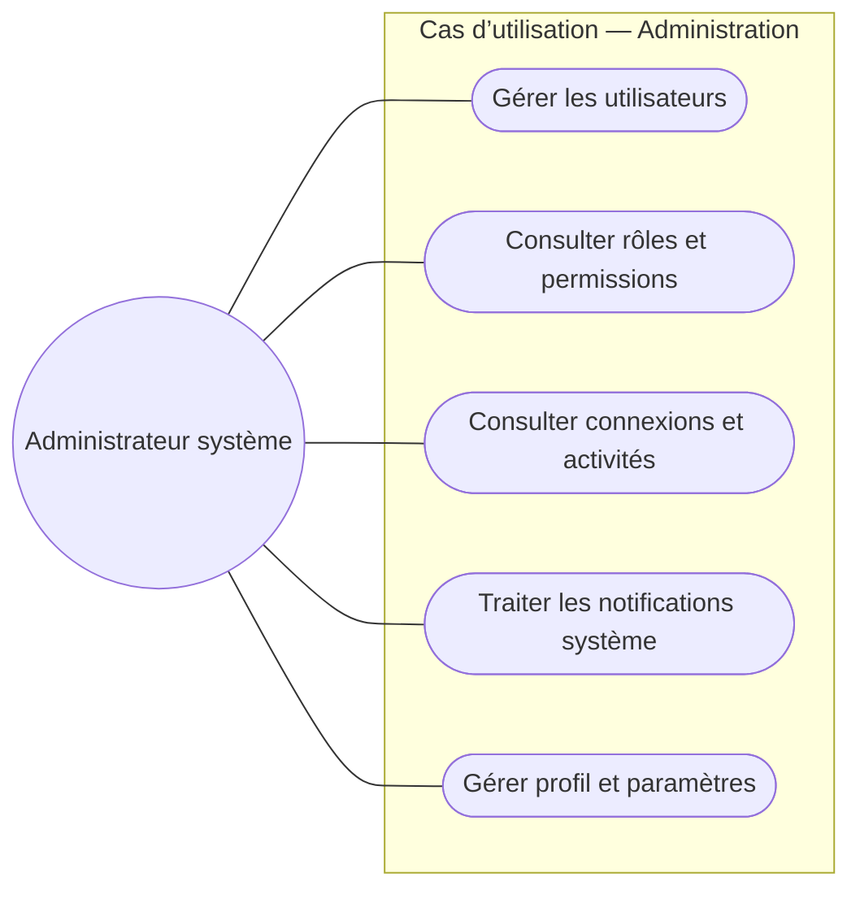

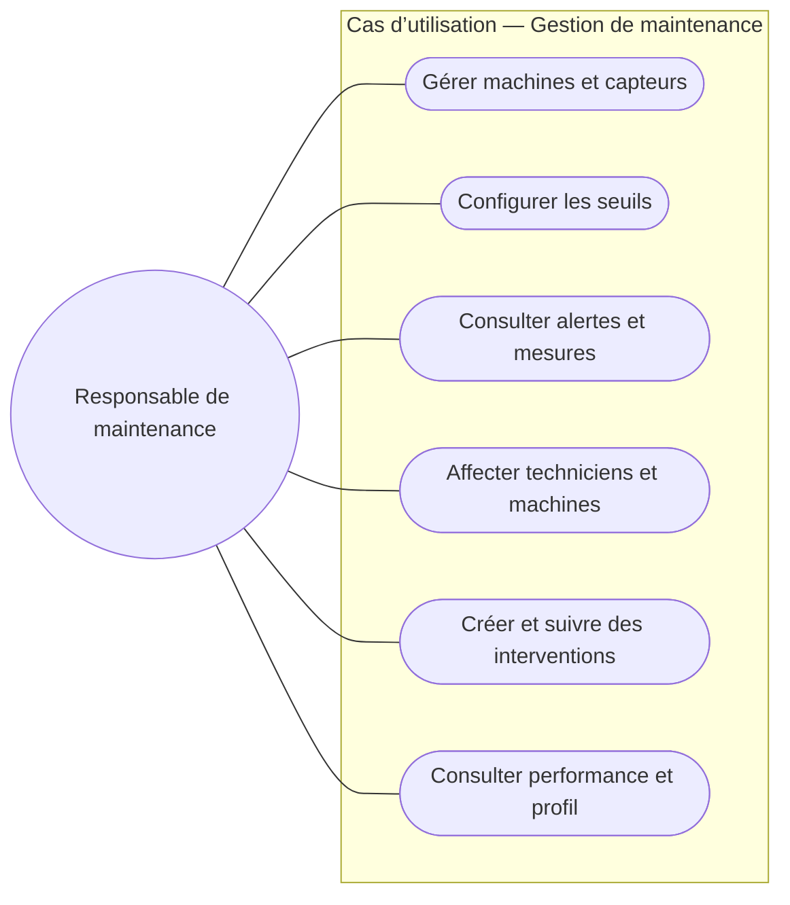

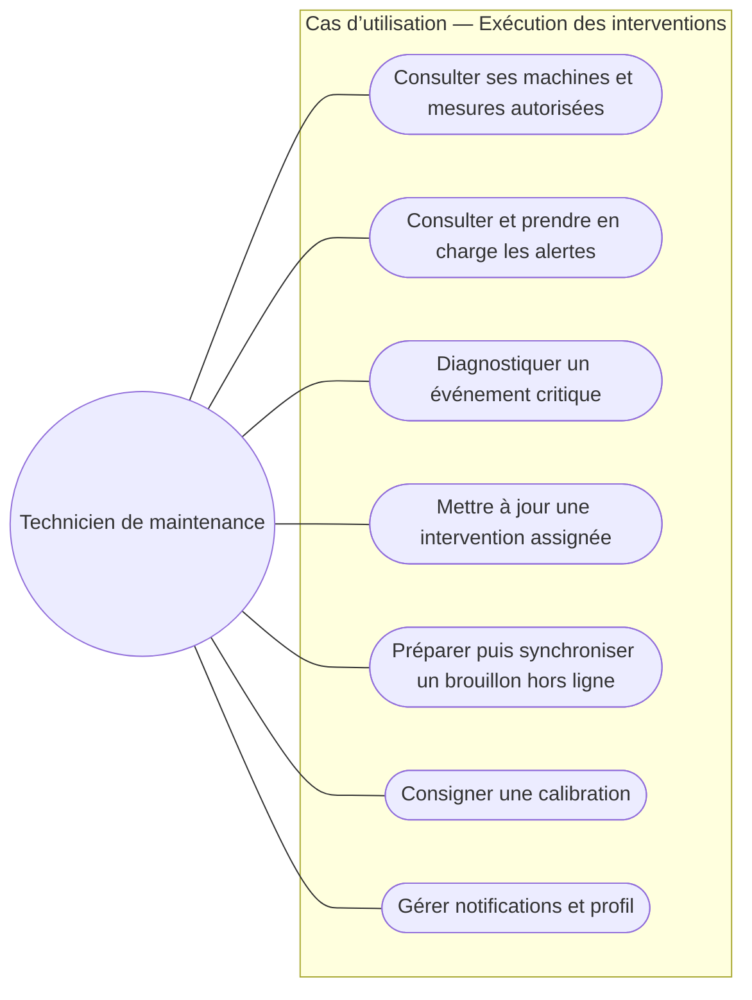

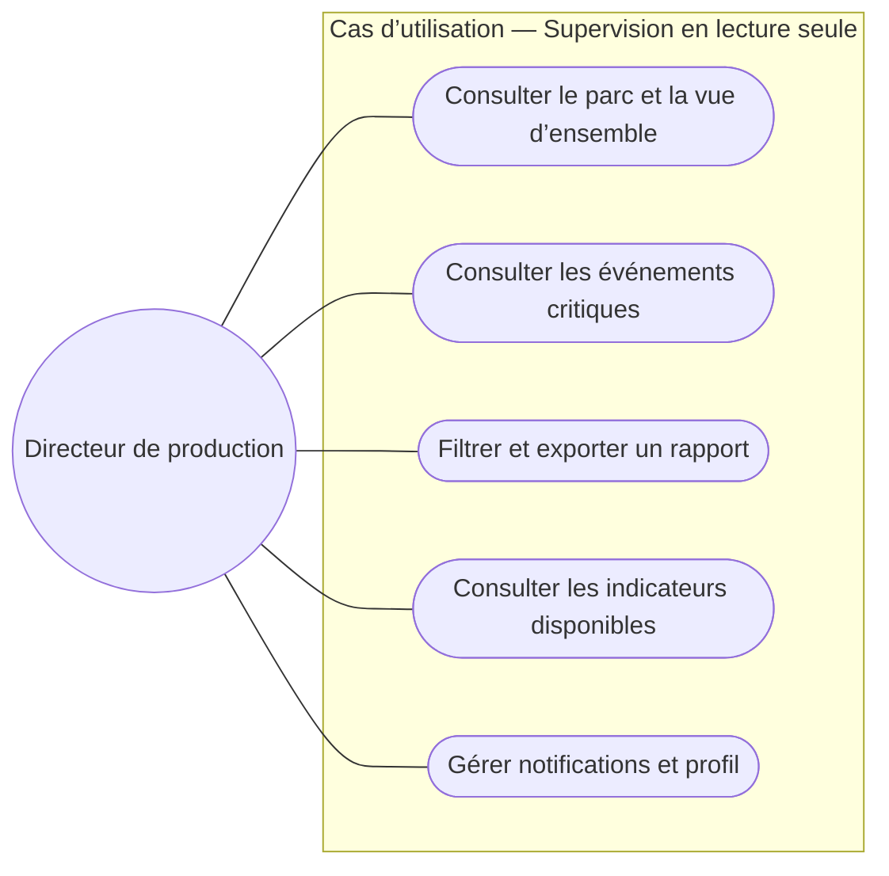

Les fonctionnalités détaillées, les routes et les exceptions par rôle sont dans
[README_Acteurs.md](README_Acteurs.md). En particulier, la disponibilité décrit
la supervision basée sur la télémétrie, tandis que les coûts sont des estimations
issues des pannes confirmées et des tarifs par machine.

### Séquences principales

Ingestion de télémétrie; le statut MQTT est un flux séparé des mesures :

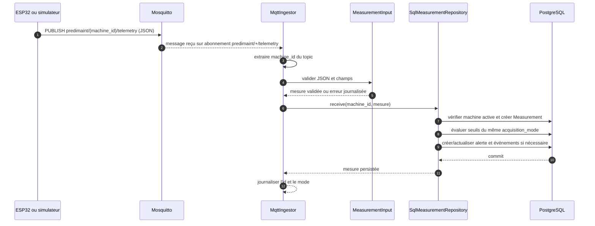

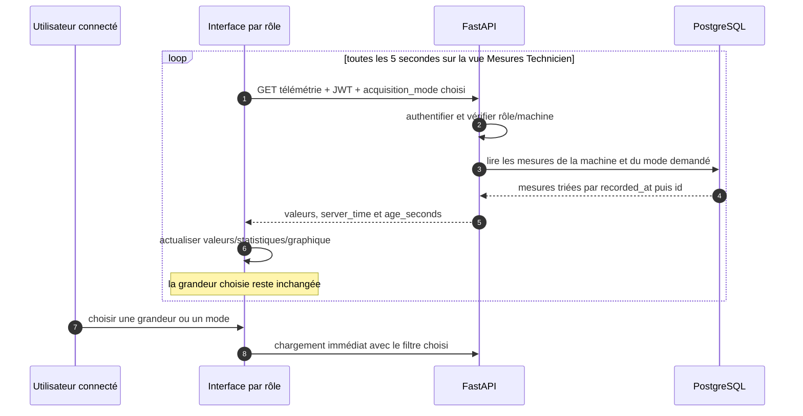

L’intervalle de 5 secondes concerne la mise à jour des mesures Technicien et ne
change pas la fréquence d’acquisition du firmware. Les requêtes API nécessitent
toujours un JWT. Le mode, la fraîcheur calculée côté serveur (seuil d’obsolescence
30 secondes) et l’état MQTT online/offline sont des notions distinctes.

### Diagramme de classes métier et relations persistées

Vue simplifiée des tables SQLAlchemy centrales. Les champs sont volontairement
limités aux identifiants, relations et attributs utiles au rapport.

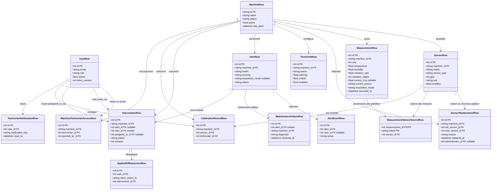

Les noms correspondent aux classes de `backend/app/infrastructure/models.py`.
Les rôles sont une valeur de `UserRow.role`, pas des sous-classes SQL séparées.
`UserNotificationRow.user_id` et plusieurs journaux d’administration sont
historiquement identifiés sans clé étrangère SQL déclarée; ne leur attribuez pas
une intégrité référentielle qui n’existe pas dans le modèle.

Le remplacement d’un capteur conserve l’ancien enregistrement désactivé et crée
un nouvel enregistrement actif. `SensorReplacementRow` conserve le motif, la date
et l’identité de l’administrateur; `MeasurementSensorSourceRow` associe chaque
nouvelle mesure physique à son capteur par grandeur. Les mesures historiques déjà
présentes ne contiennent pas cette provenance et ne sont pas attribuées
rétroactivement.

### Diagrammes d’états

Transitions de suivi d’une intervention applicables au Technicien; l’API contrôle
également l’affectation, la révision et la présence du travail réalisé avant
`completed`.

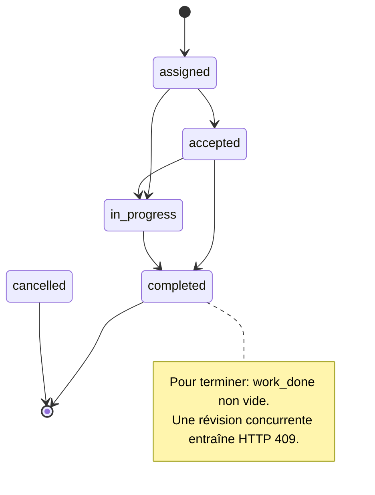

L’état de disponibilité MQTT et la fraîcheur des données ne sont pas confondus :

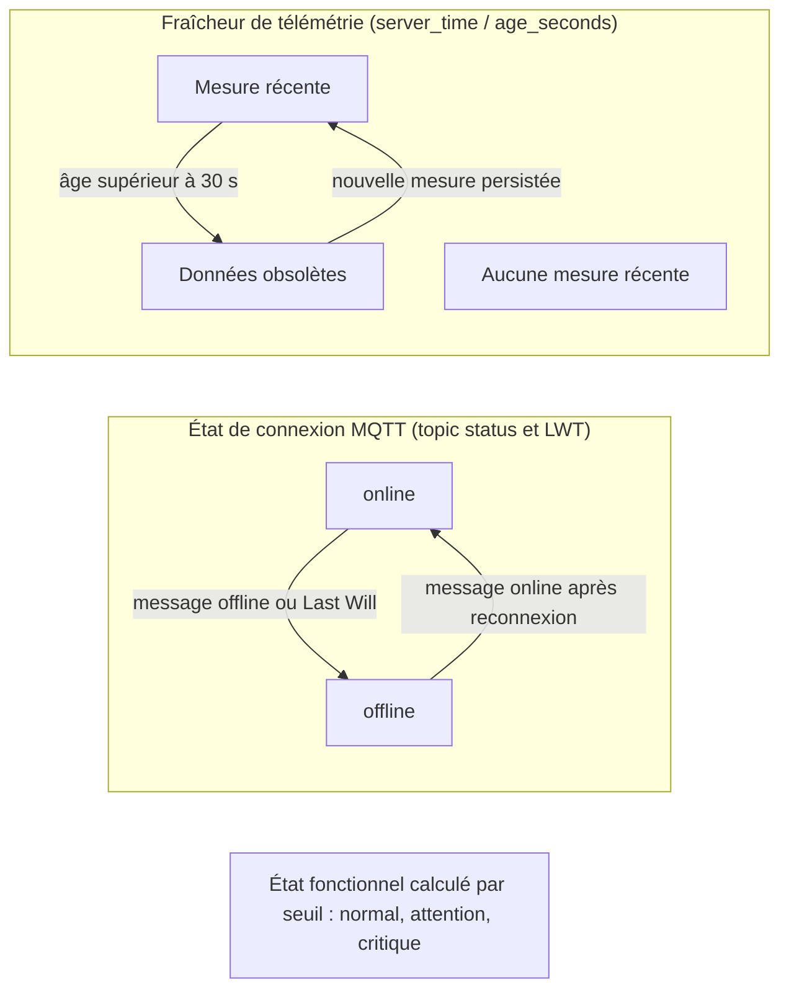

Ces axes décrivent des états différents : un broker peut signaler une machine
online alors que sa dernière télémétrie est obsolète; un événement critique ne
signifie pas nécessairement qu’une panne a été confirmée.

### Diagrammes de packages et de déploiement

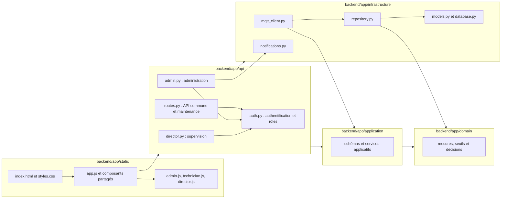

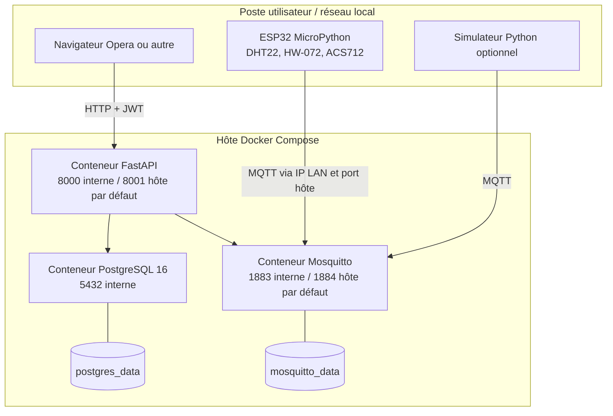

Les ports hôte peuvent être changés par configuration. PostgreSQL reste dans le
réseau Docker par défaut; ses données résident dans `postgres_data`. N’utilisez pas
`docker compose down -v` pour préserver les volumes persistants.

### Schéma fonctionnel de câblage — ESP32

Le câblage ci-dessous reflète les GPIO configurés dans
`firmware/config.example.json`; il s’agit d’un schéma fonctionnel, pas d’un plan
électrique de fabrication. Vérifiez le brochage de chaque module et les niveaux
logiques avant tout raccordement.

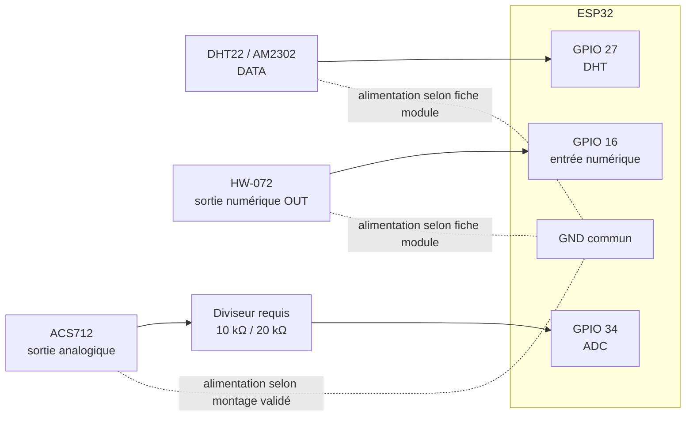

La masse doit être commune et la tension appliquée aux entrées ESP32 doit rester
dans les limites admissibles; l’ACS712 nécessite notamment un diviseur et une
vérification de la tension ADC avant l’activation du mode courant matériel. Le
firmware exemple utilise `current_mode="simulated"` par défaut. De plus,
`simulate_missing_sensors=true` remplace une lecture DHT en échec par des nombres
de démonstration tout en gardant `acquisition_mode="hardware"` : cette option doit
rester désactivée sur une acquisition physique et toute donnée issue de cette
simulation ne doit pas être présentée comme une mesure de capteur.

## Acquisition et contrat des mesures

### Topics MQTT

```text
predimaint/{machine_id}/telemetry
predimaint/{machine_id}/status
```

Le topic `status` transporte `online`/`offline` et utilise le Last Will du client.
L’ACL Mosquitto limite un appareil à ses propres topics : le client ID MQTT de
l’ESP32 doit être identique au `machine_id`. Le compte backend est distinct et
dispose d’un accès de lecture aux topics des machines.

### Modes distincts

- `acquisition_mode` décrit le parcours de la mesure : `simulated` ou `hardware`.
- `current_source` décrit indépendamment la provenance du courant :
  `simulated`, `hardware` ou `unavailable`.
- `current_rms` est le courant RMS en ampères; il ne doit pas être confondu avec
  `I_dc`. Quand la source du courant est `unavailable`, le backend conserve
  `current_rms` comme `NULL`, et non comme une mesure de zéro.
- Les seuils et alertes sont isolés par `acquisition_mode`. Les anciennes alertes
  dont le mode est `NULL` sont conservées et ont une origine historique inconnue.

Le contrat de télémétrie comprend `seq`, `temperature`, `humidity`,
`vibration_rate`, `vibration_edges`, `current_rms`, `current_source` et
`acquisition_mode`. `recorded_at` est attribué par le backend lors de la réception.
`seq` peut repartir à 1 après un redémarrage ESP32; pour l’ordre et la
déduplication, utiliser l’horodatage puis l’identifiant PostgreSQL, jamais
`seq` seul.

Les filtres API suivants sont disponibles; ils requièrent un jeton et une
autorisation sur la machine lorsque cela s’applique :

```text
GET /api/machines/{machine_id}/telemetry?acquisition_mode=hardware
GET /api/alerts?acquisition_mode=simulated
GET /api/technician/overview?acquisition_mode=hardware
```

Sans paramètre de mode, l’API conserve la compatibilité avec la lecture des deux
modes. Les colonnes `alerts.acquisition_mode` et `measurements.current_rms` sont
nullable pour préserver les historiques lors des migrations additives.

### Mode simulé

Le simulateur Python n’a pas besoin d’un ESP32. Il peut publier des valeurs
normales, critiques ou un cycle qui traverse les seuils :

```powershell
Push-Location backend
..\.venv\Scripts\python.exe -m app.simulation --machine-id demo-machine --scenario cycle --interval 5
Pop-Location
```

Scénarios disponibles : `normal`, `critical` et `cycle`. Arrêtez le simulateur
avec `Ctrl+C` avant de démarrer un autre émetteur pour la même machine. Le
simulateur et le firmware peuvent sinon se remplacer mutuellement comme client
MQTT.

### Mode matériel

1. Dans Thonny, sélectionnez l’interpréteur MicroPython ESP32 et la carte voulue.
2. Enregistrez le firmware en `/main.py` et la configuration locale en
   `/config.json` sur l’ESP32. Ne copiez pas aveuglément l’exemple si votre câblage
   diffère; les broches de l’exemple sont des valeurs de référence.
3. Dans `config.json`, utilisez l’adresse IPv4 LAN du PC qui héberge Docker et le
   port MQTT hôte (1884 par défaut), pas le nom Docker `mosquitto`.
4. Gardez `machine_id` identique au client ID et au segment machine du topic,
   par exemple `demo-machine`.
5. Vérifiez le JSON réellement publié et les logs backend, puis relisez PostgreSQL.

`acquisition_mode=hardware` ne garantit pas que toutes les grandeurs sont
physiques : `current_source` décrit séparément le courant. Ne
modifiez pas les paramètres de câblage ou de calibration pour faire passer un
test logiciel. Le HW-072 est une sortie numérique d’événements, pas un
accéléromètre étalonné.

**Limite DHT22 :** si le firmware encode une panne DHT22 sous forme de température
ou d’humidité égale à zéro, le backend ne peut pas distinguer ce cas d’une vraie
mesure à zéro sans indicateur explicite envoyé par le firmware. Cette situation
reste non résolue sans modification du firmware; les zéros ne sont pas supprimés
ou réinterprétés automatiquement.

## Installation et exécution

### Prérequis

- Docker Desktop avec Docker Compose;
- Windows PowerShell pour les commandes ci-dessous;
- Python pour le simulateur local et les tests hors Docker;
- Node.js uniquement pour vérifier la syntaxe des scripts JavaScript;
- Thonny et une carte ESP32 pour le mode matériel.

### Configuration locale

Depuis la racine du dépôt :

```powershell
Copy-Item .env.example .env
```

Renseignez localement les secrets PostgreSQL, JWT, comptes MQTT et comptes initiaux
dans `.env`. Configurez `DATABASE_URL` avec les mêmes identifiants PostgreSQL que
ceux utilisés par Compose. Ne copiez aucun vrai mot de passe dans le README, dans
`config.example.json`, dans les logs ou dans Git. Modifier un mot de passe dans
`.env` après la première création des comptes ne change pas automatiquement les
mots de passe déjà hachés en base.

### Démarrer l’application

```powershell
docker compose up -d --build
docker compose ps
Invoke-RestMethod http://localhost:8001/api/health
```

Attendu : les services backend, PostgreSQL et Mosquitto sont actifs; PostgreSQL et
Mosquitto sont `healthy`; `/api/health` retourne `status: ok`. Ouvrez ensuite
`http://localhost:8001`. Les migrations applicatives s’exécutent au démarrage du
backend. Faites une sauvegarde de PostgreSQL avant une mise à jour qui comporte
une migration.

Pour suivre les journaux :

```powershell
docker compose logs -f backend mosquitto postgres
```

Pour arrêter les conteneurs tout en conservant les volumes :

```powershell
docker compose down
```

**N’utilisez pas `docker compose down -v`** pour un arrêt ou une mise à jour
ordinaire : l’option `-v` supprime les volumes persistants, notamment les données
PostgreSQL.

### Sauvegarder PostgreSQL avant une migration

L’application fournit également une sauvegarde dans l’espace Administrateur
(menu **Sauvegardes PostgreSQL**), avec historique, téléchargement et planification
automatique configurable. La fréquence initiale est quotidienne (1 440 minutes).
Les commandes manuelles ci-dessous restent une solution indépendante pour créer
un dump avant une migration; elles écrivent dans le stockage local de l’utilisateur :

```powershell
$backupDirectory = Join-Path $env:LOCALAPPDATA "PrediMaint\backups"
New-Item -ItemType Directory -Force -Path $backupDirectory | Out-Null
$backup = Join-Path $backupDirectory ("predimaint-" + (Get-Date -Format "yyyyMMdd-HHmmss") + ".sql")
$command = "docker compose exec -T postgres pg_dump -U predimaint -d predimaint --no-owner --no-acl > `"$backup`""
cmd.exe /d /c $command
if ($LASTEXITCODE -ne 0) { throw "La sauvegarde PostgreSQL a échoué." }
Get-Item -LiteralPath $backup | Select-Object FullName,Length
```

Adaptez l’utilisateur et la base si vous avez remplacé les valeurs par défaut.
Protégez le dump comme une donnée sensible; ne le commitez pas et ne le placez pas
dans un dossier synchronisé vers un service cloud sans validation de votre
politique de stockage.

### Lancer le simulateur

Installez les dépendances Python une fois :

```powershell
if (-not (Test-Path .venv\Scripts\python.exe)) { python -m venv .venv }
.\.venv\Scripts\python.exe -m pip install -r backend\requirements.txt
```

Lancez le simulateur dans un terminal séparé, après le démarrage de Docker :

```powershell
Push-Location backend
..\.venv\Scripts\python.exe -m app.simulation --machine-id demo-machine --scenario cycle --interval 5
Pop-Location
```

Utilisez un compte MQTT appareil configuré localement. Les mesures simulées sont
marquées `acquisition_mode=simulated`; elles ne prouvent pas le fonctionnement
physique des capteurs.

## Tests et validation manuelle

### Tests automatisés

Avec Docker démarré :

```powershell
docker compose exec -T backend pytest -q
```

Le jeu de tests couvre les règles de validation, les accès par rôle, le stockage,
les filtres de mode, la séparation des alertes et les cas d’indisponibilité du
courant. Il utilise une base SQLite isolée pour les tests API : il ne valide pas
une carte ESP32 physique ni la livraison réelle d’un e-mail SMTP.

Vérification de la syntaxe des scripts JavaScript :

```powershell
Get-ChildItem backend\app\static\*.js | ForEach-Object {
    node --check $_.FullName
    if ($LASTEXITCODE -ne 0) { throw "Erreur JavaScript : $($_.Name)" }
}
```

Vérification Python ciblée :

```powershell
.\.venv\Scripts\python.exe -m py_compile `
  backend\app\main.py `
  backend\app\api\routes.py `
  backend\app\api\admin.py `
  backend\app\api\director.py `
  backend\app\api\auth.py `
  backend\app\infrastructure\mqtt_client.py
```

### Vérifications manuelles de bout en bout

1. **Services** : exécutez `docker compose ps` et vérifiez
   `Invoke-RestMethod http://localhost:8001/api/health`.
2. **Authentification** : `/api/machines` sans jeton doit répondre `401`. C’est
   normal et attendu. Connectez-vous via l’application ou `/api/auth/login`, puis
   utilisez le jeton Bearer dans Swagger (`/docs`). Ne rendez pas les routes
   publiques pour supprimer cette réponse.
3. **Simulateur** : démarrez `cycle`; observez les logs backend, puis consultez
   les mesures `simulated` et les alertes dans l’espace associé.
4. **Matériel** : arrêtez le simulateur, démarrez l’ESP32 et vérifiez le client ID,
   le topic, le JSON, les logs de validation et l’insertion. Le backend doit
   distinguer `hardware` de `simulated`.
5. **Base** : relisez les dernières mesures sans vous fier à `seq` seul :

   ```powershell
   docker compose exec postgres psql -U predimaint -d predimaint -c "SELECT id,machine_id,seq,temperature,humidity,vibration_rate,current_rms,current_source,acquisition_mode,recorded_at FROM measurements WHERE machine_id='demo-machine' ORDER BY recorded_at DESC,id DESC LIMIT 10;"
   ```

6. **Filtrage API** : une requête authentifiée sur
   `/api/machines/demo-machine/telemetry?acquisition_mode=hardware` doit exclure
   les lectures simulées. Le filtre `simulated` doit produire l’inverse.
7. **Alertes** : faites passer un même mode au-dessus puis sous un seuil de test.
   Une lecture de l’autre mode ne doit ni modifier ni fermer son alerte.
8. **Rôles** : testez les quatre comptes avec des droits distincts. Un Technicien
   ne voit que ses machines attribuées; un Directeur ne peut pas effectuer les
   opérations d’administration ou de maintenance réservées.
9. **Compte et profil** : testez la modification de profil, la révocation de
   session après changement du mot de passe et la réinitialisation via SMTP si
   configuré.
10. **Navigateur** : connectez-vous dans Opera ou un autre navigateur. Si un onglet
    était déjà ouvert pendant une mise à jour, rechargez la page; le service worker
    ne met pas en cache les requêtes `/api`.

Les procédures par acteur, les données de test, les scénarios d’interventions,
les notifications, le mode hors ligne et la calibration sont détaillés dans
[README_Acteurs.md](README_Acteurs.md) et
[README_RELEASE_1.md](README_RELEASE_1.md).

## Sécurité, sauvegardes et limites

- Conservez `.env`, `firmware/config.json`, `mosquitto/passwd`, les jetons et les
  dumps de base hors du dépôt. Utilisez `.env.example` uniquement comme liste de
  paramètres à configurer.
- L’API utilise JWT Bearer et vérifie rôle, expiration, état du compte et
  autorisation de machine. Un `401` sans jeton valable est attendu.
- Mosquitto interdit l’accès anonyme et applique une ACL; le profil local ne
  configure pas TLS. Ne rendez pas ce broker accessible à un réseau non fiable.
- Le mode hors ligne Technicien utilise un cache navigateur et des brouillons
  locaux. Ces données restent propres à l’appareil/navigateur; synchronisez-les et
  déconnectez-vous sur un appareil partagé.
- Les notifications externes sont par courriel SMTP si configuré. L’intégration
  WhatsApp n’est pas présente.
- Les règles prédictives disponibles sont des seuils déterministes, pas un modèle
  statistique ou d’apprentissage automatique.
- La calibration dans l’application consigne une observation; elle ne reprogramme
  pas l’ESP32.
- L’espace Technicien, le tableau du Responsable et les synthèses Directeur
  sélectionnent un mode d’acquisition; les alertes sont filtrées par défaut sur
  Réel et permettent aussi toutes les origines ou les alertes historiques inconnues.
  Les réponses de mesure exposent `server_time` et `age_seconds`; les vues affichent
  les dates en `Africa/Tunis` et signalent les données obsolètes après 30 secondes.
  L’état MQTT reste distinct de la fraîcheur des mesures.
- L’échec DHT22 encodé en zéro ne peut pas être détecté sans un signal de validité
  distinct envoyé par le firmware.

## Avancement et guide de reprise

Cette section sert de point de transfert quand le travail reprend dans une autre
session ou avec un autre compte Copilot. Le dépôt et ses fichiers sont la source de
vérité; l’historique de conversation ne doit pas être nécessaire à la reprise.

### US-44 — sauvegarde PostgreSQL

L’espace Administrateur contient une page dédiée, protégée côté API par le rôle
`admin`. Les endpoints sont `GET /api/admin/backups`,
`POST /api/admin/backups`, `GET /api/admin/backups/{backup_id}/download`,
`GET /api/admin/backups/config` et `PUT /api/admin/backups/config`. Le backend
utilise les binaires PostgreSQL 16 `pg_dump` et `pg_restore`, reçoit l’URL de base
depuis la configuration serveur, et n’expose aucun secret au navigateur. Les
archives custom sont vérifiées avant d’être indiquées comme réussies.

Les fichiers vivent dans le volume nommé `predimaint_backups`, distinct de
`postgres_data`; les dates, statuts, tailles et paramètres de planification sont
enregistrés en base. L’automatisation est initialement quotidienne (1 440 minutes)
et le planificateur redémarre avec le backend. Pour tester rapidement, un
administrateur peut choisir un intervalle d’une minute, attendre une exécution,
puis rétablir 1 440 minutes. Il n’y a pas de suppression automatique des anciennes
archives : les fichiers de sauvegarde sont des données sensibles et l’espace disque
du volume doit être surveillé. Aucune restauration sur la base de production n’est
proposée.

Vérification réelle consignée le **18 novembre 2026** : un dump de 192 425 octets a
été créé et `pg_restore --list` l’a reconnu; sa restauration dans un conteneur
PostgreSQL temporaire isolé a réussi (20 tables et 4 077 mesures); une sauvegarde
automatique à une minute a aussi réussi (193 735 octets), puis la fréquence a été
rétablie à 1 440 minutes. Les fichiers et métadonnées ont survécu à
`docker compose restart` complet. Ces opérations n’ont pas supprimé de volume.
L’API a répondu 401 sans jeton; les tests automatisés vérifient le refus des rôles
non administrateurs (403) et les routes de téléchargement. L’essai réel via le
bouton et le téléchargement authentifié dans le navigateur reste à faire avec une
session administrateur valide.

### État fonctionnel documenté

- **Socle** : application web HTML/CSS/JavaScript servie par FastAPI, API
  authentifiée par JWT, PostgreSQL, Mosquitto avec authentification/ACL et
  exécution locale par Docker Compose.
- **Acteurs** : espaces Administrateur, Technicien, Responsable et Directeur
  présents. Les permissions principales sont contrôlées côté API; le Technicien
  est limité aux machines auxquelles il a été autorisé.
- **IoT** : ingestion MQTT sur `predimaint/+/telemetry` et
  `predimaint/+/status`; validation des mesures, persistance par machine, seuils et
  alertes. Les parcours `hardware` et `simulated` restent distincts.
- **Mesures Technicien** : l’interface actualise les mesures toutes les 5 secondes,
  conserve la grandeur sélectionnée et signale la fraîcheur avec l’horodatage
  serveur. Les tests navigateur effectués avec une API simulée ne constituent pas
  un essai du matériel.
- **US-09 / US-25** : la fiche machine présente les dernières mesures, capteurs,
  alertes actives et interventions attribuées; les photos d’intervention (JPEG,
  PNG ou WebP, 8 Mio maximum) sont stockées dans un volume Docker séparé.
- **US-27** : Web Push fonctionne uniquement après configuration de clés VAPID,
  inscription volontaire du navigateur et permission système. Une réponse
  positive du service Push ne prouve pas l’affichage effectif sur l’appareil.
- **US-43** : les nouvelles mesures et alertes enregistrent l’arrivée au backend,
  le traitement de l’alerte et l’accusé de réception par l’application. Le
  firmware actuel ne transmet pas l’horodatage de capture, et aucun SLA n’est
  configuré; une cible de 30 secondes détection→application est proposée à la
  validation, pas appliquée comme seuil.
- **Limites fonctionnelles** : les règles d’alerte sont déterministes, pas un
  modèle prédictif entraîné. WhatsApp n’est pas intégré. Les indicateurs qui
  exigent des historiques industriels absents sont signalés indisponibles.

### Dernière vérification logicielle consignée

Les résultats ci-dessous documentent l’état antérieur de la Release 1. La
validation de la présente itération Technicien figure dans la section suivante.
État vérifié le **18 novembre 2026**; relancer ces commandes avant une livraison,
après une modification ou dans un nouvel environnement :

| Vérification | Résultat consigné | Portée / limite |
|---|---|---|
| `docker compose exec -T backend pytest -q` | 40 tests réussis, 0 échec; 773 avertissements | Tests backend/API; ils ne testent pas l’ESP32 physique |
| `node --check` sur les scripts JavaScript modifiés | Réussi | Vérification de syntaxe, pas une preuve de rendu exhaustif |
| `python -m py_compile backend\tests\test_api.py` | Réussi | Syntaxe Python du fichier de test ciblé |
| `git diff --check` | Réussi | Espaces et marqueurs de patch |
| `http://localhost:8001/api/health` | HTTP 200, `{"status":"ok"}` | Santé du backend à cet instant |
| Shell, script Technicien et service worker `v15` | HTTP 200 | Ressources statiques US-44 présentes |
| Sauvegarde manuelle PostgreSQL | Réussie, 192 425 octets; vérifiée par `pg_restore --list` | Créée via le service interne faute de session administrateur valide pour le bouton UI |
| Restauration isolée | Réussie; 20 tables, 4 077 mesures | Conteneur temporaire `--network none`, sans volume ni port publié |
| Sauvegarde automatique à 1 minute | Réussie, 193 735 octets | Fréquence remise à 1 440 minutes après l’essai |
| Persistance après `docker compose restart` | Fichier et historique conservés, `/api/health` OK | Redémarrage de services sans supprimer les volumes |
| Navigateur avec réponses API simulées | Vue Technicien / mesures mises à jour; sélection et intervalle contrôlés | Ne vérifie ni les capteurs, ni une livraison MQTT réelle |

Les avertissements pytest incluaient des dépréciations de dépendances et d’horodatage;
aucun test n’a échoué lors de cette exécution.

### Ajouts Technicien — validation de cette itération

Résultats exécutés sur le code source local, sans utiliser le conteneur backend
actuellement déployé :

| Vérification | Résultat réel | Limite |
|---|---|---|
| `.\.venv\Scripts\python.exe -m pytest -q backend\tests` | 47 réussis, 0 échec, 1 avertissement de dépréciation | SQLite isolé; pas une validation PostgreSQL de production |
| `node --check` sur les scripts JavaScript | Réussi | Syntaxe seulement, pas un test de rendu navigateur |
| `docker compose config -q` | Réussi | Valide la configuration; ne démarre pas ni ne redémarre les services |
| Diagnostics/syntaxe Pylance `routes.py`, `web_push.py`, `repository.py` | Aucun problème signalé | Fichiers ciblés seulement |
| `git diff --check` et `git diff --cached --check` | Réussis | Vérification des espaces |

Les nouveaux tests couvrent la fiche machine autorisée, l’accès refusé à une autre
machine, plus de 300 interventions, leurs états/comptes rendus, les photos
(validation, limite de taille, accès et lecture), l’inscription Push et les délais
backend/réception. Le test d’envoi Web Push utilise un fournisseur simulé et ne
contacte aucun service externe. Une configuration VAPID réelle, l’affichage d’une
notification sur un navigateur/appareil, la persistance après redémarrage d’un
Docker vivant et les mesures MQTT/ESP32 restent à vérifier manuellement; les tests
SQLite ne valident pas ces points.

### À faire avant de déclarer la chaîne physique validée

1. Avec Thonny et l’ESP32 connecté, comparer plusieurs publications `Publié :` aux
   lignes PostgreSQL et aux réponses API authentifiées pour la même mesure.
2. Vérifier le client MQTT, le topic de la machine et `acquisition_mode` sur le
   firmware réel; ne pas lancer simultanément simulateur et ESP32 avec le même
   identifiant machine.
3. Vérifier le circuit de l’ACS712, son diviseur et la tension mesurée à l’ADC avant
   de choisir `current_mode="hardware"`. Ne pas considérer une valeur RMS nulle
   comme une panne capteur ou une preuve de courant nul.
4. Tester dans le navigateur les modes, la persistance de la grandeur sélectionnée
   sur plusieurs cycles, puis l’obsolescence après environ 30 secondes sans
   nouvelles mesures.
5. Tester une livraison SMTP réelle uniquement si elle est configurée. Aucun test
   logiciel ne prouve l’envoi WhatsApp, qui n’est pas implémenté.
6. Résoudre explicitement le cas du firmware `simulate_missing_sensors` avant tout
   usage de cette option : les valeurs de remplacement sont actuellement publiées
   avec `acquisition_mode="hardware"`.

### Reprendre dans une autre session ou avec un autre compte

1. Ouvrir ce README, puis [README_Acteurs.md](README_Acteurs.md) pour le détail des
   écrans et parcours; lire également `backend/app/main.py`,
   `backend/app/infrastructure/mqtt_client.py`,
   `backend/app/infrastructure/repository.py` et
   `backend/app/infrastructure/models.py` avant de modifier le backend.
2. Vérifier `git status --short` et `git diff` avant toute modification. Les
   changements présents dans un espace de travail local ne sont pas transmis à un
   autre clone ou au compte GitHub tant qu’ils ne sont pas sauvegardés/partagés par
   le workflow Git de l’utilisateur. Ne pas écraser les modifications non validées.
3. Ne jamais copier `.env`, les vrais identifiants, jetons, dumps PostgreSQL ou
   `firmware/config.json` dans un prompt ou un dépôt partagé.
4. Démarrer avec `docker compose up -d --build`, vérifier
   `docker compose ps` et `/api/health`, puis lancer les tests ciblés avant la suite
   complète.
5. Après un changement des fichiers statiques, reconstruire avec
   `docker compose up -d --build backend` et faire un rechargement forcé du
   navigateur (`Ctrl+Shift+R`). Ne pas supprimer les volumes et ne jamais utiliser
   `docker compose down -v`.

## Documentation complémentaire

- [README_Acteurs.md](README_Acteurs.md) — fonctionnalités, permissions et
  explications techniques par rôle.
- [README_RELEASE_1.md](README_RELEASE_1.md) — installation détaillée, parcours
  matériel/simulé et scénarios de validation de la Release 1.
- [docs/releases/release-1/trello-board.md](docs/releases/release-1/trello-board.md)
  — préparation des cartes et critères Release 1.
